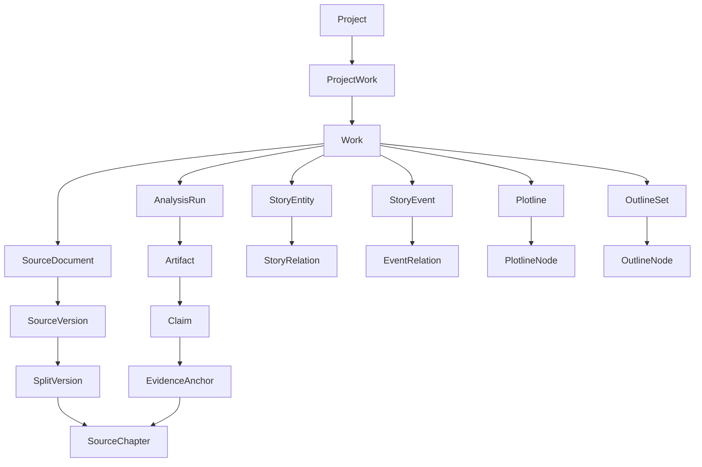

# Core Domain Model

## 1. Domain boundaries

### Source and reading domain

Owns uploaded bytes, normalized source versions, split versions, chapters, reading position, notes, and source location. Source content is the evidence base and must not be overwritten by AI analysis.

### Story structure domain

Owns entities, aliases, relations, events, event relations, plotlines, outline sets, outline nodes, claims, and evidence anchors. It converts text into navigable story data.

### AI workflow domain

Owns analysis runs, step state, idempotency, model/prompt provenance, artifacts, validation, retries, cancellation, and incremental recomputation.

### Creative design domain (P0)

Owns creative brief, story concepts, character/relationship design, planned events, plotlines, planned outline sets, design constraints and design diagnostics. It reuses entity/event/outline primitives while keeping planned events distinct from events extracted from published source text.

### Manuscript writing domain (later phase)

Owns manuscript chapters, manuscript revisions, accepted prose and fine-grained consistency findings. It reuses creative design and Canon, but does not treat generated draft text as published-source evidence.

## 2. Core terms

- **Project:** workspace boundary for a user's work, access control, and settings.
- **Work:** a book/story being studied or written. A project may reference multiple works.
- **Source document:** uploaded file and storage metadata.
- **Source version:** immutable normalized text derived from one source document and parser/normalization configuration.
- **Split version:** immutable chapter segmentation over one source version.
- **Source chapter:** one chapter in one split version. Its text and offsets are valid only for that split version.
- **Analysis run:** one asynchronous execution with an explicit input manifest and reproducibility metadata.
- **Artifact:** a versioned output such as a chapter outline, book overview, entity report, or plotline analysis.
- **Claim:** an individually reviewable statement extracted or inferred by analysis.
- **Evidence anchor:** a location and quoted span in a specific source chapter that supports or challenges a claim.
- **Story entity:** a canonical character, place, organization, object, or concept within a work. Entity mentions record each source-specific occurrence and exact text span.
- **Story event:** a canonical event in the story. Event mentions record the source-specific occurrence, chapter, local order, narrative order, story-time label, and optional exact text span. This separation allows the same event to be represented across different editions/split versions without storing a single chapter pointer on the canonical event.
- **Plotline:** a story arc such as the main plot, subplot, mystery, romance, or character arc.
- **Outline set:** a versioned hierarchical outline with an explicit semantic mode.
- **Outline node:** a book, volume, act, story arc, chapter, scene, or beat within an outline set.

## 3. Relationship overview

The diagram is conceptual. Actual foreign keys and delete rules are defined in the SQL migration.

## 4. Semantic invariants

### Source immutability

- Uploaded bytes are identified by checksum and stored under an immutable object key.
- A parser or normalization change creates a new source version.
- A chapter-boundary change creates a new split version.
- Chapters from different split versions must never be silently mixed in one analysis run.
- Offsets are zero-based, half-open character offsets over canonical normalized chapter text, using Unicode code points rather than UTF-8 byte offsets.
- Every evidence anchor stores the chapter identity and quoted text/hash so it can be revalidated.

### Analysis provenance

Every run records:
- work and project;
- source and split versions, when source-based;
- task type and requested scope;
- pipeline version, execution profile, idempotency key, input hash and input manifest; model/provider/prompt/schema metadata is recorded per run step because a pipeline may use multiple models.
- idempotency key and input manifest;
- status, progress, errors, and timestamps.

Every generated artifact points to the run that produced it where applicable. Manual edits create a new revision or an explicit human-reviewed state; they do not rewrite run history.

### Knowledge status

Claims use two independent dimensions:
- Epistemic status: explicit, inferred, speculative.
- Review status: unreviewed, accepted, rejected, edited.

A confidence score is a model estimate for prioritization, not a guarantee of truth. Human acceptance does not erase the original provenance.

### Outline modes

- **reverse_analysis:** a structure inferred from an existing source and therefore tied to a source/split version.
- **planned_outline:** an author's intended future structure; source version is optional and may refer to inspirations rather than a canonical source.

These modes may share tree operations but must not be semantically conflated.

### Entity resolution

- Canonical entities are work-scoped.
- Alternate names and aliases are stored separately.
- Entity merge/split actions must preserve an audit trail and update references transactionally.
- Similarity alone must not automatically merge two characters with ambiguous identities.

### Story order

Narrative order is distinct from in-world chronology. Events may be narrated out of order through flashbacks, framing narratives, or parallel timelines. Store narrative order and story-time description separately.

## 5. Cross-domain change propagation

- New source version: prior source-derived artifacts become stale for the new source.
- New split version: chapter-level artifacts and evidence anchors tied to the previous split version remain historical; they are not silently reassigned.
- Entity merge/split: update relation and plotline references in a transaction and record the operation.
- Plotline edit: update only the affected plotline nodes and derived summaries.
- Outline edit: create a new outline revision or node revision according to the implementation's chosen revision strategy.
- Model/prompt change: does not mutate prior artifacts; a new run produces a new revision.

## 6. Decisions intentionally deferred

- Graph database: use relational edge tables first.
- Event sourcing: do not introduce a full event-sourcing architecture for MVP; keep explicit revision/audit records for important mutations.
- Multi-user live editing: use optimistic concurrency/version checks first.
- Universal knowledge graph: keep the story model bounded to the current work until cross-work comparison is implemented.

## 7. Canonical entities versus source mentions

Canonical story entities/events are work-level concepts. Entity mentions and event mentions are version-specific observations in source chapters. This distinction is required for alias resolution, multiple editions, changed chapter boundaries, and traceable evidence. A source mention must never be silently rebound to a different split version.
